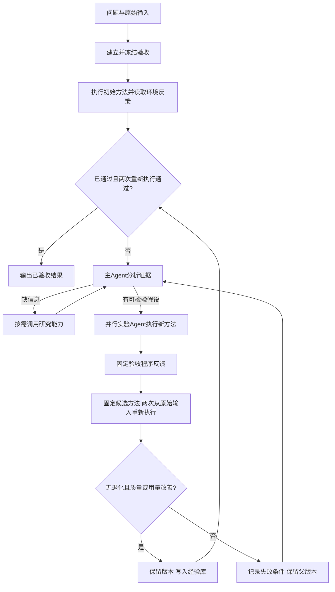

# General RSI 0.1.1

给一个问题，由主 Agent 建立验收、按需调研、提出方法、分配实验 Agent、读取环境反馈，再修改和复测可复用的方法经验。通过验证的经验会在后续相关问题中检索使用。

默认所有角色使用现有 Pi 账户里的 **智增增 `deepseek-v4.1-flash`**。主 Agent、实验 Agent、复测 Agent 和默认研究 Agent 都走同一配置。核心只需要 Linux、Python 3.11+ 和已经能调用模型的 Pi；不需要安装 Python 第三方依赖。凭据沿用账户配置或环境变量，本包不包含任何密钥。

## 直接试用

在144服务器上：

```bash
cd /home/jianghp3/general-rsi-20261114-v0.1.1
./run.sh doctor
./run.sh ask '创建一个Python脚本，计算1到1000中能被3或5整除的整数之和，并保存结果。请用独立计算验收。'
```

`ask` 后面直接写问题即可。不指定 `--workspace` 时，每次从空目录开始；有代码、数据或工具说明时传入输入目录：

```bash
./run.sh ask '读取amounts.csv，用Decimal精确求amount列总额，输出answer.json。' \
  --workspace /绝对路径/输入目录
```

结果默认放在 `~/.local/share/general-rsi/goals/goal-时间-随机后缀/`。控制台最终 JSON 中的 `goal_directory` 是本次目录，`final_answer` 是说明文件；实际产物位于 `workspaces/<answer_attempt>/`。`report.json` 给出状态、预算、模型用量和验收来源，`answer.md` 是最终回答。模型原始会话和环境回执保留在该目录中。

`--output /绝对路径/新目录` 可指定结果位置，**必须在输入目录之外**。`--memory /绝对路径/经验库` 可指定跨问题共享的经验；默认是结果目录的上级下的 `memory/`，默认启动方式下多次提问会共享它。原始输入不会被工作副本覆盖。输入内的 `.git`、虚拟环境、`node_modules`、`.env*` 和常见密钥文件不会复制；有未忽略的符号链接时会拒绝运行，需先整理输入。

离线检查整个闭环，不调用模型：

```bash
./run.sh demo
python3 -m unittest discover -s tests -v
```

`demo` 使用明确标记的脚本 Agent 和真实 Python 计算器，只验证框架，不代表模型能力。真实调用和测试范围见 [VALIDATION.md](VALIDATION.md)。

## 实际循环



每条候选修改的是完整的方法指导，包括观察、假设、适用范围和证据来源。控制器把它注入下一次全新 Agent 执行；没有改进证据就不会把它当作成功经验。候选需要至少两次独立重新执行，同一方法不能靠反复复测直到碰巧成功。验证分数不能低于父版本；同质量下只有实际测得 token 减少才可用效率理由保留。失败条件独立存储为负面证据，不作为已验证指导注入。

它属于**固定模型、方法经验演化的非参数 RSI 原型**：改进执行策略，并让后续执行使用改进结果。它不会训练模型权重，也不会任意改写控制器和验收规则。仅一个问题的两次复测不能证明跨任务普遍改善；经验检索目前是中英文词项匹配，仍由 Agent 判断适用性。

Deep Research 是主 Agent 遇到具体信息缺口时才调用的能力。没有缺口时直接实验。默认研究角色也使用现有 Pi 工具；要调用144上原有的 NexAU Deep Research，可以单独换研究角色的接口，不必替换主循环。

## 反馈与验收

无需每次先选反馈类型。默认优先使用你提供的环境验收；未提供时，Agent 在解题前生成独立 Python 验收程序，然后冻结它。如果目标无法计算验证或缺少必要工具，系统应给出具体阻塞原因。人可以追加方向反馈，但不能用聊天中的“通过”替代环境验收。

已有测试、仿真或评分程序时，直接指定命令。命令以 argv 数组传入，不经过 shell，在候选工作目录内运行，退出码0表示通过：

```bash
./run.sh ask '修复功能，使原有测试通过。' \
  --workspace /绝对路径/项目 \
  --verify-command '["python3","-m","pytest","-q"]'
```

需要连续评分、硬约束和详细诊断时用 JSON 验收。以下例子可直接运行，评分器已随包附带：

```bash
./run.sh ask '在整数[-20,20]中最小化(x-7)^2，将x写入result.json。' \
  --verify-command "[\"python3\",\"$PWD/examples/demo_verifier.py\",\"{workspace}\"]" \
  --verify-mode json --check-ids integer_domain,minimum
```

JSON 评分器输出：

```json
{
  "passed": true,
  "score": 1.0,
  "checks": [
    {"id": "requirement", "passed": true, "evidence": "实际计算或测试观测"}
  ],
  "feedback": "可操作的诊断",
  "hard_constraints": {"constraint_name": true},
  "metrics": {}
}
```

`score` 必须是0到1的有限数，`checks` 必须保留冻结的全部 ID，整体 `passed` 必须等于全部检查通过。只有成功产生 JSON 时退出0，候选不合格仍可输出 JSON 并退出0。超时、缺失检查、删除失败检查、伪造格式或违反硬约束都会被拒绝。模型自己声称成功不构成回执。

自动生成的检查标记为 `agent_proposed`，人工/环境提供的标记为 `user_provided`。**`solved` 表示通过这些冻结检查，并不保证自动检查覆盖了问题的每个要求。**重要的科学、优化和工程目标，应接入你认可的环境验收。控制器会检查自身代码、输入快照及验收文件哈希；工作副本隔离不等于操作系统安全沙箱。

## 持久化、反馈和预算

```bash
./run.sh status /本次/goal目录
./run.sh feedback /本次/goal目录 '新发现：仿真在边界条件下不稳定，请先检查边界。'
./run.sh resume /本次/goal目录
./run.sh resume /本次/goal目录 --extra-agent-calls 20 --extra-seconds 1800
```

人类反馈在下一规划边界生效；不会改写已经冻结的验收。`resume` 会复用完成的调用和回执。`Ctrl-C` 会中止当前本地进程组并保留结果。控制器若崩溃，遇到“已启动但完成状态未知”的调用不会擅自重复：先检查它是否仍在运行、是否产生外部作业，再明确处理：

```bash
./run.sh reconcile /本次/goal目录 --call 调用目录名 --mark-failed
./run.sh reconcile /本次/goal目录 --kind verifier --call 验收目录名 --mark-failed
./run.sh resume /本次/goal目录
```

`reconcile` 只把已确认不再运行的未知调用记为失败，不会伪造成功或重复提交作业。模型侧仍可能已计费，因此未知用量不会按0处理。失败的规划/初始化调用再次恢复时使用新的调用 ID，原失败证据保留。运行中不要修改 `general_rsi/*.py`；旧目标恢复需要同一控制器版本。

默认资源预算：10轮方法改进、40次 Agent 调用、40次验收、并行2个实验、每个新方法2次复测。默认不设置时间上限。主 Agent、研究、实验、复测和格式修复都计入调用预算；一轮可以包含多次研究和模型调用。达到配置的调用或用量预算时会保存状态停止。可复制 `examples/pi.json` 修改后用 `--config` 指定。

0.1.1起 `agent_timeout`、`max_seconds`、`verifier_timeout` 默认均为 `null`，控制器不再给单次Agent、整个目标或验收程序设置时间硬截止。只有明确设为正数时才启用对应时限。Agent提示也要求不要在没有时间预算时自行套用旧经验中的固定期限，优先完成并验证答案。调用次数和用量预算仍有效，运行可手动中止并恢复。已有工具/API自己的超时由其框架配置。旧目标保留创建时的配置与控制器版本，不会被新版暗中改变。

可设置 `max_tokens`、`max_cost_usd`，但它们只能在收到用量后阻止新的调用，正在执行的调用可能超额。缺少完整用量时相应预算检查会阻塞。Pi 未配置价格时，报告 `total_model_cost_usd: null`，不能解释为免费；`known_cost_usd` 只是已知部分。外部仿真/集群费用和外部作业取消由工具框架负责，本控制器只能管理自己启动的本地进程组，不能自动回收任意集群作业。

## 接入现有 Agent 和 Deep Research

通过 `backend.type=command` 可以调用已有 Agent 框架。命令从 stdin 读取：

```json
{"schema_version":1,"role":"worker","instructions":"角色指导","input":{},"call_id":"唯一调用ID"}
```

stdout 只返回一个 JSON，日志写 stderr：

```json
{"text":"最终回答或规划JSON字符串","usage":{"total_tokens":1234,"cost_usd":null}}
```

无法取得完整用量时用 `"usage": null`，不能报0。`{request}` 可替换为已落盘请求文件。完整例子见 `examples/demo_agent.py`。

仅替换研究角色时，在默认 Pi 配置的 `backend` 中增加：

```json
{
  "role_commands": {
    "research": [
      "/home/jianghp3/agentic-harness-engineering/.venv/bin/python",
      "/home/jianghp3/general-rsi-20261114-v0.1.1/examples/nexau_research_bridge.py",
      "--agent-yaml",
      "/home/jianghp3/agentic-harness-engineering/.code_sources/nexau@v0.3.9/examples/deep_research/deep_research_agent.yaml"
    ]
  }
}
```

上面是要合并到 `backend` 内的字段，不是独立完整配置。桥接器将主研究 Agent 及其全部子 Agent 统一设为智增增 Flash；凭据读取 `ZHIZENGZENG_API_KEY`，也兼容 `ZZZ_API_KEY`/`OPENAI_API_KEY`。它不从旧代码复制凭据，也不自动安装 NexAU 或配置其搜索工具。**该 NexAU 桥接仅完成接口和源码兼容检查，未完成真实 Deep Research 联调；默认可运行入口不依赖它。**已有其他研究框架时按同一 stdin/stdout 协议接入即可。

`--baseline-existing` 可先评估输入中的现成产物，不调用 Agent 生成初始版本。它适合已有方案优化，不能当成“同模型改进前”的比较。默认会实际调用 Agent 执行初始方法。

文件、图片/视频和skill的输入方式另见 [INPUTS.md](INPUTS.md)，附带通用表格取证skill示例位于 `examples/skills/spreadsheet-evidence/`。

研究依据、复用边界及原有代码分类见 [PROVENANCE.md](PROVENANCE.md)。
